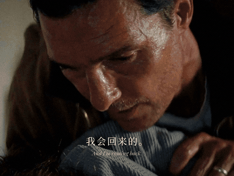
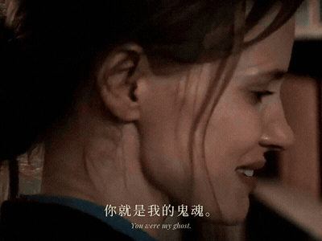
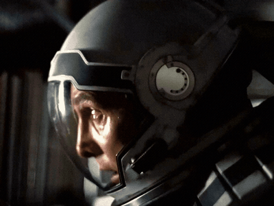

# mixcut 电影混剪

给一个主题（"友谊""父亲"）或一部片名（"星际穿越"），它自己找片、下片、找配乐，剪一条 20–60 秒的混剪。先找到一句原台词把题立住，再让很多画面把这句话说完，结构跟着曲子走。



这是用这个 skill 剪的测试片《星际穿越》，54 秒，4:3，59 个镜头，镜头中位数 0.47 秒，这里压成了没有声音的 GIF。上面这段是开头：他说完"我会回来的"，片名出来，落拍那一刀正好是火箭点火，从慢切进快。

开场第一句是库珀坐在熟睡的女儿床边说的："当了父母，你就成了孩子未来的鬼魂。"结尾长大的墨菲把它兑现："It was you. You were my ghost."



结尾她说"我知道你会回来，因为我爸答应过我"，最后停在床边那一镜，淡出。


开头和结尾是同一个床边，角色倒过来。

## 这个风格难在哪

让 AI 直接剪混剪，它会先挑好看的镜头，按节拍一拍一切排满，再配几句台词、加转场。出来的是卡点视频或者预告片。

这个风格反过来：

> 是一句话被很多画面说出来，不是好看的镜头按节拍排一遍。

后面的规矩都从这句话来：

- 开场用一句原片里有态度的台词立题，结尾兑现它。找不到这句话就不开剪。
- 台词接成一条越说越重的对话链，跨镜头、跨电影也要像同一场对话。
- 结构挂在曲子的形状上：安静、蓄力、落拍、快、急停、慢、最慢。
- 落拍、段落交接、高潮这几刀卡死在音乐上，其余跟着台词和动作切。
- 最快那段之后突然停住，用一个大特写把最重的那句话放完。
- 特效只用在这几个关键点上，其余全是硬切。
- 每一镜都要看得清一张脸、一个状态。



高潮这段从两拍一切到一拍、半拍，越切越碎，然后突然停在他喊 STAY 的大特写上。

## 怎么用

```bash
git clone https://github.com/HeyChengC/mixcut.git ~/.claude/skills/mixcut
pip install numpy scipy opencv-python pillow soundfile librosa faster-whisper "av<17" rapidocr-onnxruntime scenedetect yt-dlp
pip install torch demucs
```

ffmpeg 也要装，放进 PATH。

模型和字体不随仓库给，放进 skill 根目录的 `library/`（设了环境变量 `STUDIO_ROOT` 就放 `$STUDIO_ROOT/library/`）：

- `library/models/faster-whisper-small/`：转写台词用。`python scripts/pget.py --hf Systran/faster-whisper-small library/models/faster-whisper-small` 能下。
- `library/models/face_detection_yunet_2023mar.onnx`：找脸用，在 OpenCV Zoo 里。没有就全部居中裁。
- `library/fonts/`：思源宋体 `NotoSerifSC-VF.ttf`，Playfair Display 的 `Regular`、`Italic`、`MediumItalic`。没有就退回系统里的宋体和 Georgia。
- 分离人声的 demucs 模型第一次用时自己下。

装完重启 Claude Code，跟它说"剪一条星际穿越的混剪"，或者"给你个主题：父亲，你自己剪"。

它会先给你看立意、开场那句台词和结尾用什么画面，你点头了再去找素材。之后下 360p 代理、分离人声、逐词转写、切镜头、排段落表、渲染预览，自己审片改至少两轮，定稿时只把用到的那几秒拉成高清出成片。YouTube 要登录才能下、要用浏览器 cookies 时，还有删东西之前，它都会先问你。

电影片段和配乐只放在作品目录里，不进 skill，也不进仓库。

## 里面有什么

`SKILL.md` 是 AI 读的入口：先认片型、每一站给你看什么、必须做到的 12 条、量出来的数。

| 文件 | 干什么 |
|---|---|
| `references/editing.md` | 剪辑逻辑：切点听谁的，相邻两镜怎么接（动手前必读） |
| `references/story.md` | 内容逻辑：立意、立论句、台词链、按什么挑镜头 |
| `references/picture.md` | 画面：这一镜放什么，镜头看着不对怎么办 |
| `references/rhythm.md` | 节奏和情绪：哪里快哪里慢，情绪怎么一步步推 |
| `references/arc.md` | 开头 5 秒、高潮那几镜、结尾那一镜 |
| `references/transitions.md` | 转场：只用在哪几处，怎么做 |
| `references/type.md` | 字：开场大字、逐词字、字幕、片名 |
| `references/music.md` | 挑曲子、截段、接缝打分 |
| `references/footage.md` | 找片、下片、转写台词、切镜头；YouTube 被拦怎么办 |
| `references/engine.md` | 剪辑表 `edl.json` 和 build 脚本怎么写 |
| `references/production.md` | 命令清单、审片、交片前自查 |
| `references/taste.md` | 看片时说过的话，变成了哪条规则 |
| `scripts/fetch.py` | 搜片、下片、下配乐，定稿后拉高清 |
| `scripts/lines.py` | 分离人声、逐词转写，在所有素材里搜一句台词 |
| `scripts/shots.py` | 切镜头、量脸和亮度、出联系表、挑入点 |
| `scripts/music.py` | 拍子、小节、落拍，推荐截段，给接缝打分 |
| `scripts/render.py` `fx.py` | 按剪辑表逐帧渲染，转场和字 |
| `scripts/edl_check.py` `qc.py` | 渲染前查剪辑表，渲染后查响度、黑帧、冻帧、切点 |
| `scripts/fsheet.py` `small.py` `pget.py` | 逐帧联系表、看图前先缩图、慢网多连接下载 |
| `examples/interstellar.md` | 《星际穿越》这条：段落表、每段为什么这样剪 |
| `examples/refs.md` | 三条参考片的骨架 |

## 现在的状态

- 剪辑逻辑是从三条混剪参考片逐镜头拆出来的：名单式 17 秒、单人物情绪 24 秒、主题群像 42 秒。
- 用这套逻辑只剪过一条测试片《星际穿越》v4，还没收到反馈。
- "只给主题、跨很多部电影"的流程还没真跑过。
- 这条片有 5 个镜头还是 360p，YouTube 要登录才能下高清。
- README 里的动图是电影画面，这个仓库只能私有。
